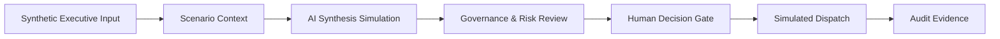

# Architecture

## Current public showcase

The active application is a **static Executive AI Command Center showcase**. Its purpose is to demonstrate executive AI workflow design, governance and human authorization without exposing or duplicating the private operational system.

Cross-cutting layers:

- multilingual presentation in EN / PT / AR;
- RTL support for Arabic;
- static media and executive walkthrough assets;
- deterministic client-side interactions;
- no production backend and no real external dispatch.

## Design principles

### 1. Demonstrate the operating model, not the private engine

The public repository should make the workflow understandable and credible while keeping real operational logic, opportunity data, negotiation history, provider infrastructure and internal decision rules private.

### 2. Human authorization is explicit

The Human Decision Gate is the central governance principle: AI may prepare and synthesize, but an external commitment must remain behind explicit human authorization.

In this repository, the post-gate action is simulated. The showcase does not send real email, update a real client system or perform another production-side effect.

### 3. Governance must be visible

Risk, approval state and audit evidence should be visible enough that an executive can understand who remains accountable for a decision.

### 4. Synthetic context stays synthetic

The public experience uses synthetic scenarios and presentation data unless explicitly documented otherwise. Private or unknown operational facts must not be filled in merely to improve the demo.

### 5. Public and operational systems remain separate

The public showcase is not the canonical runtime for:

- Proposal Intelligence;
- operational routes such as `Principal`, `Quick Win` and `Productized Offer`;
- Wii Finance / V15 product operations;
- private scoring and evidence admission rules;
- real proposal generation and negotiation history;
- outcome learning and operational memory.

Those belong primarily to the private Opportunity Cockpit. A concept may later be demonstrated here only when it has a clear portfolio or commercial function.

## Active runtime boundary

The current active surface is centered on:

- `index.html` — executive UI and presentation structure;
- `app.js` — deterministic client-side interaction logic;
- `data/i18n.js` — multilingual text and scenario content;
- `assets/` — walkthrough, audio and visual evidence used by the showcase.

The application is intentionally static and suitable for GitHub Pages.

## Legacy V1 boundary

The original opportunity-evaluation prototype is preserved under `legacy_v1/`.

`data/opportunities.json` is also retained as synthetic legacy data from that earlier direction. The active Executive AI Command Center does not load that file. It remains for traceability and should not be treated as the current domain model.

## Private production boundary

The private system may contain operational components such as:

- real opportunity ingestion and normalization;
- evidence-backed analysis;
- Proposal Intelligence;
- commercial routing and productized offers;
- Human Gate enforcement around real actions;
- traces, evaluation records and outcome feedback;
- operational memory and internal decision rules;
- authenticated integrations and provider routing.

These components are intentionally not defined by this public repository.

## Architectural rule

When a new concept is developed in the private Opportunity Cockpit, do **not** copy it automatically into this showcase.

First ask whether exposing it improves the commercial demonstration. If not, keep it in the operational system and preserve the public/private boundary.
